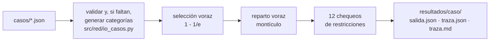

# Proyecto ADA 2026-2 · Red

**Selección de participantes y reparto del presupuesto de ruido** · Primera entrega

| | |
|---|---|
| **Autor** | Jacobo Uribe Montoya |
| **Código** | 36921 |
| **Curso** | Análisis y Diseño de Algoritmos 2026-2 · Universidad de Caldas |
| **Docente** | Luz Enith Guerrero Mendieta |
| **Versión** | ver el archivo [`VERSION`](VERSION) (hoy 1.1.0); cada salida la registra |

Una red de N nodos entrena un modelo en conjunto. En cada ronda el programa decide:

1. **Quiénes participan (Parte 2).** Elige k nodos que cubran la mayor cantidad de categorías de datos distintas. El problema es NP-difícil, así que se usa un voraz con garantía de al menos el 63 % del óptimo (1 − 1/e). Si dos nodos aportan lo mismo, gana el de mayor coeficiente.
2. **Cuánto recibe cada uno (Parte 1).** Reparte B unidades de presupuesto de ruido entre los k elegidos para maximizar la utilidad total. El voraz con montículo es exacto y cuesta O(k + B log k).



## Ejecutar

Requisito: **Python 3.10 o superior**. La ejecución de casos no necesita instalar nada.

```bash
python src/ejecutar_casos.py                 # 1. ejecuta todos los .json de casos/
python -m unittest discover -s tests          # 2. (opcional) 33 pruebas automáticas
```

Después, abrir `resultados/resumen.md` y `resultados/<caso>/traza.md`. En Windows, si `python` no se reconoce, usar `py`.

| Quiero… | Comando |
|---|---|
| Ejecutar un solo caso | `python src/ejecutar_casos.py --casos casos/otro.json` |
| Probar sin tocar `resultados/` | `python src/ejecutar_casos.py --casos mi_caso.json --salida resultados_prueba` |
| Más repeticiones para medir el tiempo | `python src/ejecutar_casos.py --repeticiones 20` |
| Otra forma de u_i(x) | `python src/ejecutar_casos.py --utilidad raiz` (`log`, `raiz`, `saturada`) |
| Ver en un archivo las categorías sintéticas de un caso | `python src/completar_categorias.py entrada.json -o salida.json` |
| Casos de práctica | `python src/ejecutar_casos.py --casos casos/ejemplos --salida resultados_ejemplos` |
| Experimentos y gráficas del informe | `pip install -r requirements.txt` y `python Informe/code/experimentos.py` |
| Recompilar el informe | `cd Informe` y `pdflatex main.tex` (tres veces) |
| Ver todas las opciones | `python src/ejecutar_casos.py --help` |

Para agregar un caso basta con copiar su `.json` a `casos/`, tal como se recibió, y volver a ejecutar; no hay que editar código ni el archivo.

## Dónde está cada cosa

| Qué busco | Dónde |
|---|---|
| Informe (formalización, NP-dureza, T(n), resultados, experimentos y tabla de correspondencia con la guía) | [Informe/main.pdf](Informe/main.pdf); fuentes LaTeX en `Informe/secciones/` |
| Manual técnico | [docs/manual_tecnico.md](docs/manual_tecnico.md) |
| Manual de usuario | [docs/manual_usuario.md](docs/manual_usuario.md) |
| Caso de la profesora (sin modificar) | [casos/entrada_G2_red_15_nodos.json](casos/entrada_G2_red_15_nodos.json) |
| Resumen de resultados y tiempos | [resultados/resumen.md](resultados/resumen.md) |
| Resultado, tiempo y verificación de un caso | `resultados/<caso>/salida.json` |
| Traza: selección, ganancias marginales, reparto y restricciones | `resultados/<caso>/traza.md` (y `traza.json`, `traza_*.csv`) |
| Código de los algoritmos | [src/red/seleccion.py](src/red/seleccion.py), [src/red/reparto.py](src/red/reparto.py) |
| Pruebas automáticas | [tests/test_proyecto.py](tests/test_proyecto.py) |
| Experimentos y gráficas | `Informe/code/` e `Informe/img/` |

## Resultado del caso de la profesora (`entrada_G2_red_15_nodos`)

N = 15, k = 5, B = 30 y u_i(x) = w_i·ln(1 + x), con w_i el coeficiente dado por la profesora. La entrada no trae categorías de datos, así que son **sintéticas**: el programa las genera al leer el archivo (semilla 36921, 20 categorías, entre 3 y 7 por nodo), sin modificarlo, y la salida lo declara en `origen_categorias`. La forma ln(1 + x) es un supuesto de modelado; se cambia con `--utilidad`.

| | Resultado |
|---|---|
| Selección | N04, N15, N14, N13, N06: 20 de 20 categorías, igual al óptimo exacto (C(15, 5) = 3003 evaluaciones) |
| Reparto de B = 30 | N04 = 7, N15 = 5, N14 = 6, N13 = 5, N06 = 7 |
| Utilidad | 99.5821, igual al óptimo por programación dinámica para esos cinco nodos |
| Tiempo | 0.018 ms (mediana de 5; depende del equipo) |
| Verificación | 12 de 12 chequeos |

33 grupos distintos cubren las 20 categorías; al desempatar por coeficiente, el voraz entrega uno con utilidad 99.58 (desempatando por posición, la versión 1.0.0 entregaba 92.58). Selección y reparto se resuelven en secuencia, así que no se garantiza el mejor de esos grupos (107.04).

Es la solución **base**: las variantes (costos de participación, rondas con fallas, nodos relacionados) quedan para la siguiente entrega.

## Estructura

```
VERSION  README.md  requirements.txt  pyproject.toml
casos/        entradas .json tal como se reciben · ejemplos/ (casos de práctica)
src/          ejecutar_casos.py, completar_categorias.py, generar_casos_ejemplo.py
  red/        utilidad, seleccion, reparto, verificacion, pipeline, io_casos, reporte, generador
resultados/   generado por src/ejecutar_casos.py
tests/        test_proyecto.py
docs/         manual_tecnico.md, manual_usuario.md
Informe/      main.tex, main.pdf, formato.sty, secciones/, img/, code/ (experimentos)
```

## Consistencia de versión

Informe, código, manuales y resultados corresponden a la versión del archivo `VERSION`. Cada `salida.json`, `traza.json`, `traza.md` y `resumen.md` la registra, y una prueba automática comprueba que coincidan. Al cambiar el código o los casos, se actualiza `VERSION` y se vuelve a ejecutar `python src/ejecutar_casos.py`.

## Créditos y referencias

- **Autor:** Jacobo Uribe Montoya (36921).
- Nemhauser, Wolsey y Fisher (1978), *Mathematical Programming* 14 · Feige (1998), *Journal of the ACM* 45(4) · Khuller, Moss y Naor (1999), *Information Processing Letters* 70(1) · Karp (1972), *Complexity of Computer Computations*.
