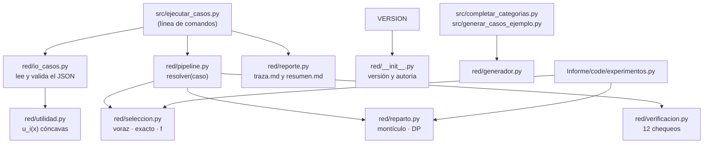

# Manual técnico · Proyecto ADA 2026-2 (Red)

> **Autor:** Jacobo Uribe Montoya · **Código:** 36921 · **Versión del código:** 1.1.0 (archivo `VERSION`)
> Análisis y Diseño de Algoritmos 2026-2 · Universidad de Caldas · Primera entrega (Grupo 2 · Red)

Para usar el programa sin entrar en el código, ver el [manual de usuario](manual_usuario.md). La teoría completa (reducción, deducciones y experimentos) está en el informe, `Informe/main.pdf`.

**Índice:** [1 Resumen](#1-resumen) · [2 Modelo](#2-modelo-matemático) · [3 Arquitectura](#3-arquitectura) · [4 Algoritmos](#4-algoritmos-y-funciones-de-eficiencia) · [5 Recorrido guiado](#5-recorrido-guiado-del-código) · [6 Ejecución](#6-pasos-de-ejecución) · [7 Entrada](#7-formatos-de-entrada) · [8 Salida](#8-salidas) · [9 Verificación](#9-verificación-de-restricciones) · [10 Pruebas](#10-pruebas-automáticas) · [11 Experimentos](#11-validación-experimental) · [12 Limitaciones](#12-limitaciones)

---

## 1. Resumen

| Parte | Problema | Algoritmo | Función de eficiencia | Garantía |
|---|---|---|---|---|
| 2 · Selección | Elegir k de N nodos que maximicen f(A) | Voraz por ganancia marginal | kN − k(k−1)/2 evaluaciones = Θ(N·k) | f ≥ (1 − 1/e)·óptimo |
| 2 · Selección (referencia) | Mismo problema, óptimo exacto | Árbol «incluir / no incluir» con poda | C(N, k) evaluaciones | Exacto, solo N pequeño |
| 1 · Reparto | Repartir B unidades entre los k elegidos | Voraz con montículo | Θ(N + B log N) peor caso | Exacto |

El programa ejecuta primero la selección y después el reparto entre los nodos elegidos.

## 2. Modelo matemático

**Selección (Parte 2).** Nodos V = {1, …, N}. El nodo j aporta un conjunto S_j de categorías de datos. La utilidad conjunta es la cobertura:

```
f(A) = | ⋃_{j ∈ A} S_j |        (categorías distintas que cubre el grupo A)
```

Objetivo: max f(A) con |A| = k, 1 ≤ k ≤ N. f es normalizada (f(∅) = 0), monótona y submodular. La ganancia marginal es Δ_j(A) = f(A ∪ {j}) − f(A) = |S_j ∖ C(A)|, con C(A) lo ya cubierto. El problema es NP-difícil (reducción desde Cobertura Máxima; ver el informe).

**Reparto (Parte 1).** Para cada nodo elegido, una utilidad u_i creciente y cóncava. Objetivo: max Σ u_i(x_i) con Σ x_i ≤ B y x_i entero ≥ 0 (opcionalmente x_i ≤ tope_i). La ganancia de la unidad x + 1 es g_i(x) = u_i(x+1) − u_i(x), y la concavidad significa g_i(0) ≥ g_i(1) ≥ ….

**Tamaño de la entrada.** Selección: (N, k), más τ, el costo de evaluar f. Reparto: (N, B). B cuenta como valor, por eso la cota del reparto es pseudo-polinomial.

## 3. Arquitectura



Todo el código está en `src/`; el paquete `red` es `src/red/`.

| Módulo | Responsabilidad | Funciones principales |
|---|---|---|
| `red/__init__.py` | Versión (leída del archivo `VERSION`) y autoría | `__version__`, `PROYECTO`, `AUTOR`, `CODIGO` |
| `red/io_casos.py` | Lee y valida los dos formatos de caso | `cargar_caso`, `parsear_caso` |
| `red/utilidad.py` | Utilidades cóncavas u_i(x) | `Log`, `Raiz`, `Saturada`, `Tabla`, `para_coeficiente`, `desde_dict` |
| `red/seleccion.py` | Parte 2 | `f_cobertura`, `seleccion_voraz`, `seleccion_exacta`, `desde_cobertura_maxima` |
| `red/reparto.py` | Parte 1 | `repartir_voraz`, `repartir_dp` (solo para verificar) |
| `red/verificacion.py` | Restricciones y propiedades teóricas | `verificar` |
| `red/pipeline.py` | Une todo, mide tiempos y compara con óptimos | `resolver` |
| `red/reporte.py` | Textos legibles | `traza_md`, `resumen_md` |
| `red/generador.py` | Datos sintéticos reproducibles | `generar_caso`, `completar_categorias` |
| `src/ejecutar_casos.py` | Programa principal | `main`, `escribir_caso`, `traza_json`, `fila_resumen` |
| `src/completar_categorias.py` | Categorías sintéticas para un caso que no las trae | `main` |
| `Informe/code/experimentos.py` | Validación experimental y figuras del informe | `mediana_tiempo`, `ajustar`, `experimento` |

**Representación de los conjuntos.** Cada S_j es un entero cuyo bit c está encendido si el nodo tiene la categoría c (*bitmask*). La unión es `|`, «lo que falta» es `& ~cubierto` y el tamaño es `bit_count()`. Así, una ganancia marginal cuesta τ = O(|U|/w) operaciones de palabra, con w = 64 bits.

**Flujo de `resolver`.** (1) Mide selección + reparto **sin traza** (mediana de `--repeticiones`). (2) Si C(N, k) ≤ 500 000, calcula el óptimo exacto de la selección. (3) Resuelve una vez **con traza**: el algoritmo es determinista y decide igual que al medir. (4) Verifica. (5) Si k·B² ≤ 3·10⁶, compara el reparto con la programación dinámica.

## 4. Algoritmos y funciones de eficiencia

### 4.1 Selección voraz (`seleccion_voraz`)

```
A ← ∅;  cubierto ← ∅
para paso = 1..k:
    para cada j ∉ A:  Δ_j ← |S_j ∖ cubierto|          # una evaluación de la ganancia
    agregar a A el j con mayor Δ_j        # empate: mayor p_j = u_j(1) − u_j(0); luego, menor índice
    cubierto ← cubierto ∪ S_j
```

En el paso i quedan N − i + 1 candidatos: Σ_{i=1..k} (N − i + 1) = kN − k(k−1)/2 evaluaciones. Como k ≤ N, eso queda entre kN/2 y kN, así que es **Θ(N·k)** evaluaciones y Θ(N·k·τ) de tiempo. El recorrido no depende de los datos: el mejor y el peor caso coinciden. **Garantía:** f(A) ≥ (1 − 1/e)·f(A*) ≈ 0.632·f(A*) (Nemhauser, Wolsey y Fisher, 1978), porque f es normalizada, monótona y submodular. No se puede mejorar en tiempo polinomial salvo que P = NP (Feige, 1998).

**Desempate.** p_j = u_j(1) − u_j(0) es la ganancia de la primera unidad de presupuesto del nodo j; con u_j(x) = w_j·ln(1 + x) vale w_j·ln 2, así que gana el de mayor coeficiente. Solo decide entre candidatos con el mismo Δ máximo, así que f(A) en cada paso, la garantía y el conteo de evaluaciones no cambian; sí cambia qué grupo se entrega cuando varios cubren lo mismo. En el caso de la profesora, 33 grupos cubren las 20 categorías y su utilidad va de 91.06 a 107.04: desempatando por índice (versión 1.0.0) salía 92.58; por coeficiente sale 99.58. `pipeline.py` pasa los pesos desde `caso["pesos"]`, que calcula `io_casos.py`.

### 4.2 Selección exacta (`seleccion_exacta`, solo para comparar)

Recorre el árbol «incluir / no incluir» el nodo i: (1) si |A| = k, evalúa f (hoja); (2) si quedan menos nodos que lugares libres, poda; (3) si no, ramifica en incluir i y no incluir i. Si L(n, r) cuenta las hojas con n nodos por decidir y r lugares libres:

```
L(n, r) = L(n−1, r−1) + L(n−1, r),   L(n, 0) = 1,   L(n, r) = 0 si r > n   ⇒   L(N, k) = C(N, k)
```

Es la regla de Pascal. El algoritmo evalúa f exactamente **C(N, k)** veces (las pruebas lo comprueban) y tarda O(C(N, k)·(N + τ_f)), con τ_f = O(k·|U|/w) el costo de calcular f(A) desde cero en cada hoja (el voraz, en cambio, paga τ = O(|U|/w) por ganancia porque guarda lo ya cubierto). Sin cupo, la recurrencia T(n) = 2T(n−1) + c da (τ_f + c)·2^N − c ∈ Θ(2^N). Con k = N/2, C(N, N/2) ≥ 2^N/(N+1): exponencial.

### 4.3 Reparto voraz (`repartir_voraz`)

```
x_i ← 0;  H ← montículo de máximos con (g_i(0), i)          # O(N)
mientras se hayan dado menos de B unidades y H no esté vacío:
    (g, i) ← máximo de H;  si g ≤ 0: terminar
    x_i ← x_i + 1
    si x_i alcanzó su tope: sacar i de H
    si no: reemplazar el máximo por (g_i(x_i), i)             # O(log N), heapreplace
```

Es **óptimo**, por intercambio: por concavidad, el voraz toma las B mayores ganancias. Si un reparto óptimo difiere, mover una unidad hacia el voraz no empeora la utilidad. Costo: construir el montículo O(N) más B pasos de O(log N), es decir **Θ(N + B log N)** en el peor caso y Θ(N + B) en el mejor. Es pseudo-polinomial en B. En el programa se reparte entre los k elegidos, así que allí el costo es **O(k + B log k)**, y la solución completa cuesta Θ(N·k·τ) + O(k + B log k), más leer la entrada.

**Detalles de Python.** `heapq` es de mínimos, por eso se guarda `(-g, i)`. El índice rompe empates a favor del menor. `heapreplace` hace la extracción y la inserción en una sola operación O(log N).

### 4.4 Verificadores exactos (solo pruebas y comparación)

`repartir_dp` es programación dinámica O(N·B²). `seleccion_exacta` es la de 4.2. No intervienen en el resultado que se entrega.

## 5. Recorrido guiado del código

### 5.1 Reparto a mano

Dos nodos con ganancias marginales (utilidad `Tabla`): nodo 0 = 5, 3, 2, 1; nodo 1 = 4, 4, 1, 0.5; B = 4.

| Unidad | Montículo antes (−g, i) | Elegido | Ganancia | Total |
|---|---|---|---|---|
| 1 | (−5, 0), (−4, 1) | 0 | 5 | 5 |
| 2 | (−4, 1), (−3, 0) | 1 | 4 | 9 |
| 3 | (−4, 1), (−3, 0) | 1 | 4 | 13 |
| 4 | (−3, 0), (−1, 1) | 0 | 3 | 16 |

Resultado: x = (2, 2) y utilidad 16, que es la suma de las cuatro mayores ganancias: 5 + 4 + 4 + 3.

### 5.2 Selección a mano (caso `ej00_tres_nodos`)

S_N1 = {K1, K2, K3, K4}, S_N2 = {K1, K2, K5}, S_N3 = {K3, K4, K6}, k = 2.

1. **Paso 1:** Δ = 4, 3, 3; gana N1 y quedan cubiertas K1 a K4.
2. **Paso 2:** a N2 solo le falta K5 (Δ = 1) y a N3 solo K6 (Δ = 1). Empatan y gana N2 por tener mayor coeficiente (6.0 frente a 5.0). f = 5.
3. **Óptimo:** {N2, N3} cubre las 6 categorías. Razón 5/6 ≈ 0.833 ≥ 0.632. **El voraz no siempre es óptimo.**

Con bitmasks: K1 a K6 son los bits 0 a 5. N1 = 0b001111, N2 = 0b010011, N3 = 0b101100. En el paso 2, `N2 & ~0b001111` = 0b010000, que tiene un solo bit.

### 5.3 El caso de la profesora

El archivo se lee tal como se recibió; como no trae categorías, `io_casos.py` las genera en memoria (semilla 36921). Selección: N04 (Δ = 7; empata con N06, N13, N14 y N15 y gana por coeficiente, 12.0), N15 (6; empata con N13 y gana por 9.5 frente a 8.3), N14 (4), N13 (2), N06 (1; empata con N05 y N11): f = 20 de 20. Reparto: la primera unidad va a N04 porque 12.0·ln 2 = 8.3178 es la mayor primera ganancia; la segunda a N06 (11.1·ln 2 = 7.6939). Al final: N04 = 7, N15 = 5, N14 = 6, N13 = 5, N06 = 7, con utilidad 99.5821. Todo está en `resultados/entrada_G2_red_15_nodos/traza.md`.

### 5.4 Cómo extender

| Quiero… | Dónde |
|---|---|
| Otra forma de u_i | Clase nueva en `utilidad.py`, registrada en `desde_dict` y en `para_coeficiente`/`TIPOS_COEFICIENTE` |
| Otra utilidad conjunta f | `f_cobertura` y la línea de Δ en `seleccion_voraz` (y `seleccion_exacta`) |
| Otro formato de caso | Una función nueva en `io_casos.py`, llamada desde `parsear_caso` |
| Otro chequeo | Una entrada más del diccionario `r` en `verificar` |

## 6. Pasos de ejecución

Requisito: Python 3.10 o superior. La solución base solo usa la biblioteca estándar; `matplotlib` y `numpy` hacen falta únicamente para los experimentos del informe. Todos los comandos se ejecutan desde la carpeta del proyecto (la que contiene `src/` y `casos/`); en Windows, si `python` no se reconoce, usar `py`.

1. **(Opcional) Comprobar la instalación:** `python -m unittest discover -s tests` → `Ran 33 tests … OK`.
2. **Agregar los casos:** copiar cada `.json` de la profesora, sin modificarlo, a `casos/`. Si no trae categorías, se generan al leerlo.
3. **Ejecutar:** `python src/ejecutar_casos.py`. Por cada caso imprime N, k, B, f(A), utilidad, tiempo y si cumple las restricciones.
4. **Revisar:** `resultados/resumen.md` (una fila por caso) y `resultados/<caso>/traza.md` (selección, reparto y restricciones); `salida.json` y `traza.json` tienen lo mismo en formato máquina.
5. **(Opcional) Experimentos y gráficas:** `pip install -r requirements.txt` y `python Informe/code/experimentos.py`.
6. **(Opcional) Recompilar el informe:** `cd Informe` y `pdflatex main.tex` (tres veces, para el índice y las referencias).

Opciones de `src/ejecutar_casos.py`: `--casos` (archivos o carpetas), `--salida` (carpeta de resultados), `--repeticiones` (mediana del tiempo, 5 por defecto), `--utilidad log|raiz|saturada` y `--sin-optimo`. El programa termina con código 0 si todos los casos cumplen, y con 1 si alguno no cumple o no se pudo leer.

## 7. Formatos de entrada

**Formato de la profesora** (se reconoce por la clave `parametros`; `categorias` es opcional):

```json
{
  "parametros": {"numero_nodos": 3, "cupo_participantes_por_ronda_k": 2, "presupuesto_ruido_por_ronda_B": 6},
  "funcion_utilidad": {"tipo": "log"},
  "nodos": [{"id": "N1", "coeficiente_utilidad": 4.0, "categorias": ["K1", "K2", "K3", "K4"]}]
}
```

Si un nodo no trae `categorias` (como en el archivo de la profesora), `io_casos.py` las genera en una copia en memoria con `generador.completar_categorias` (semilla 36921, universo 20, entre 3 y 7 por nodo): son las mismas que escribe `src/completar_categorias.py`, el archivo no se modifica y la salida lo declara en `origen_categorias`.

u_i(x) = w_i·ln(1 + x) con w_i = `coeficiente_utilidad` (supuesto de modelado: la entrada solo da el coeficiente). También se puede usar `raiz` (w_i·√x) o `saturada` (w_i·(1 − e^(−b·x)), b = 0.2 por defecto), con `funcion_utilidad` o con `--utilidad`.

**Formato extendido** (propio; cada nodo con su utilidad y un tope opcional):

```json
{"nombre": "ej01", "k": 3, "B": 20,
 "nodos": [{"id": 0, "cobertura": [1, 5, 7], "utilidad": {"tipo": "log", "a": 3.0}, "cap": 20}]}
```

**Validación** (`ValueError` con un mensaje que nombra el caso y el nodo): JSON con forma de objeto; claves obligatorias; `numero_nodos` igual a la cantidad de nodos; 1 ≤ k ≤ N (con k = N participan todos); B entero ≥ 0 (no se acepta `true`); ids únicos; coeficiente numérico finito > 0; categorías como **lista** de textos no vacía (un texto suelto como `"K11"` se rechaza, porque se partiría en letras); utilidad creciente y cóncava; topes enteros ≥ 0. Las claves desconocidas se ignoran.

## 8. Salidas

Por cada caso, en `resultados/<caso>/`:

| Archivo | Contenido |
|---|---|
| `salida.json` | Versión, parámetros, origen de las categorías, criterio de desempate, selección, f(A), reparto, utilidad, tiempos, óptimo exacto (si aplica), comparación con la DP y los 12 chequeos |
| `traza.json` | La traza completa en formato máquina: selección con la ganancia de **todos** los candidatos en cada paso, reparto unidad por unidad y verificación |
| `traza.md` | A. selección paso a paso (Δ, categorías nuevas, segundo mejor) · B. reparto unidad por unidad · C. verificación |
| `traza_seleccion.csv` | paso, nodo, ganancia_marginal, f_acumulada, categorias_nuevas |
| `traza_reparto.csv` | unidad, nodo, ganancia_marginal, unidades_del_nodo |

Además, `resultados/resumen.md` y `resultados/resumen.csv` (una fila por caso). **Tiempo:** mediana de `--repeticiones` (5 por defecto) de selección + reparto, sin trazas, con `time.perf_counter`. Código de salida: 0 si todo cumple y no hubo casos inválidos; 1 en otro caso.

## 9. Verificación de restricciones

| # | Chequeo | Qué garantiza |
|---|---|---|
| 1 | \|A\| = k | Cupo respetado |
| 2 | Nodos de A válidos y sin repetir | Selección bien formada |
| 3 | f(A) de la traza = f(A) recalculada | La cuenta incremental es correcta |
| 4 | Ganancias de la selección no crecientes | Submodularidad observada |
| 5 | f(voraz) ≥ (1 − 1/e)·f(óptimo) | Garantía, cuando se calculó el óptimo |
| 6 | x_i entero ≥ 0 | Reparto factible |
| 7 | x_i = 0 si el nodo no participa | Solo reciben los elegidos |
| 8 | Σ x_i ≤ B (y x_i ≤ tope) | Presupuesto respetado |
| 9 | Utilidad recalculada coincide | La suma reportada es correcta |
| 10 | Ganancias del reparto no crecientes | Concavidad observada |
| 11 | Ninguna transferencia de una unidad mejora | Optimalidad: con u_i cóncavas, equivale al óptimo global |
| 12 | No sobra presupuesto que algún nodo aproveche | No se dejan unidades útiles sin usar |

## 10. Pruebas automáticas

`python -m unittest discover -s tests -v` (o `python -m pytest -q`): **33 pruebas**, solo biblioteca estándar.

| Grupo | Pruebas | Qué comprueban |
|---|---|---|
| Reparto | 4 | Voraz = DP en 300 instancias (con y sin topes); B = 0; utilidades crecientes y cóncavas; una utilidad **no** cóncava rompe el voraz (3 frente a 11) |
| Selección | 10 | Cota 1 − 1/e frente a fuerza bruta (300 instancias, y 200 más con desempate por peso); desempate por peso; contraejemplo 5 frente a 6; exacto = C(N, k) evaluaciones y óptimo (100); voraz = kN − k(k−1)/2 evaluaciones (50); traza coherente (100); monotonía y submodularidad (300); reducción desde Cobertura Máxima (150); k inválido |
| Formato de la profesora | 6 | Caso válido y claves ignoradas; k = N aceptado; parámetros, nodos, categorías y utilidad inválidos; categorías faltantes generadas en memoria sin modificar el archivo |
| Formato extendido | 2 | Válido e inválidos |
| Completar categorías | 2 | Reproducible; la lectura del caso y el script generan las mismas categorías |
| Verificación | 2 | Detecta un reparto no óptimo y un presupuesto sin usar |
| Caso de la profesora | 2 | Resultado publicado; la traza no cambia las decisiones |
| Línea de comandos | 4 | Ejecución completa (`salida.json`, `traza.json`, `traza.md`, CSV); un caso malo no detiene a los demás; solo casos malos no escribe resumen; completar categorías desde la terminal |
| Versión | 1 | `VERSION`, el código, `pyproject.toml` y cada salida dicen la misma versión |

Calidad estática: `ruff check .` y `mypy src/red` sin errores.

## 11. Validación experimental

`python Informe/code/experimentos.py` mide 6 tamaños por experimento (semilla 2026). Cada punto es la mediana de 7 mediciones, tras una ejecución de calentamiento que no se mide y con el recolector de basura apagado. Luego ajusta t ≈ c·T(n) por mínimos cuadrados y guarda `Informe/img/*.png` y `Informe/code/experimentos*.csv`. El análisis completo está en la sección 8 del informe.

| Experimento | T(n) teórico | R² del ajuste | Crecimiento medido |
|---|---|---|---|
| Reparto vs B (N = 2000) | N + B ln N | 0.9992 | B ×32 → tiempo ×29.5 |
| Reparto vs N (B = 20N) | N + 20N ln N | 0.9859 | N ×32 → tiempo ×89 (teórico ×46) |
| Selección vs N (k = 20) | N·k | 0.9997 | N ×32 → tiempo ×32.6 |
| Selección vs k (N = 8000) | N·k | 0.9988 | k ×32 → tiempo ×40.5 |

**Lectura.** El reparto es lineal en B, y la selección es lineal en N y en k. El número de evaluaciones del voraz es exactamente kN − k(k−1)/2, comprobado por una prueba automática. En «reparto vs N» el exceso viene del montículo de Python y no del algoritmo: `Informe/code/diagnostico_heap.py` mide, con B fijo, el costo por unidad de N = 2000 a 64 000. El reparto crece ×3.73 y `heapq.heapreplace` aislado ×3.68, frente a ×1.46 esperado por log N. Es coherente con efectos de memoria fuera del modelo RAM; esa causa física no se midió directamente. Los tiempos dependen de la máquina; lo que se compara es el crecimiento.

**Mejora de esta versión.** La primera medición de un experimento salía inflada por cachés frías: el primer punto de «reparto vs B» medía 19.7 ms donde la recta predecía unos 14 ms. Ahora `mediana_tiempo` hace una ejecución de calentamiento sin medir, apaga el recolector de basura mientras mide y usa 7 repeticiones.

## 12. Limitaciones

1. La utilidad conjunta implementada es la cobertura sin pesos.
2. Selección y reparto se resuelven en secuencia, así que no se garantiza el óptimo conjunto: en el caso de la profesora el programa entrega 99.58 y el mejor grupo con cobertura completa llega a 107.04.
3. El presupuesto es entero y la cota del reparto es pseudo-polinomial.
4. El óptimo exacto de la selección solo se calcula si C(N, k) ≤ 500 000; si no, se entrega el voraz sin compararlo con el óptimo.
5. Las categorías del caso de la profesora son sintéticas (semilla 36921), porque la entrada no las trae; el grupo elegido depende de ellas. Si llegan categorías reales en el archivo, se usan en lugar de generarlas.
6. Las variantes obligatorias (costos de participación, T rondas con fallas, nodos relacionados) quedan para la siguiente entrega.
7. Las utilidades son de punto flotante y las comparaciones usan una tolerancia de 1e−9.
8. La forma u_i(x) = w_i·ln(1 + x) es un supuesto de modelado; se cambia con `--utilidad`.
